<div align="center">



<a href="https://www.linkedin.com/in/debjit-debnath-1a28a4280/"></a>
<a href="https://x.com/deeebuuuu"></a>
<a href="mailto:debjitdebnath2978@gmail.com"></a>

</div>

### `// whoami`

```python
class Debjit:
    role        = "AI engineer, in training"
    shipped_with = ["Groq", "Gemini", "OpenAI SDK", "MCP servers", "local Llama"]
    learning    = ["RAG", "LangChain", "vector databases", "evals"]
    builds      = "full-stack apps with LLMs inside them"
    looking_for = "AI / LLM engineering roles + internships"
    hours       = "mostly after midnight"
```

### `// things i shipped from this room`

| project | what it does | stack |
|---|---|---|
| [**hackradar**](https://github.com/debuuuuuu/hackradar) | scrapes Devpost, Unstop and Devfolio daily, ranks hackathons with an LLM, sends reminders on Discord and email | Python · TypeScript · Groq · Postgres · GitHub Actions |
| [**PAY3**](https://github.com/debuuuuuu/PAY3) | MCP server that lets AI agents pay on Stellar, with spend limits enforced by an on-chain contract | TypeScript · MCP · Rust/Soroban · Next.js · Prisma |
| [**SentinelAI**](https://github.com/debuuuuuu/pay-per-usage-ai-api-access-system-using-algorand) | pay-per-call AI API marketplace with job queues and Algorand payments (team of 4) | Express · Groq · Gemini · MongoDB · Redis/BullMQ |
| [**MONOMER**](https://github.com/debuuuuuu/SIHcrypto26183) | crypto-fraud tracing dashboard with an LLM investigation assistant | Next.js · OpenAI SDK · Neon Postgres |
| [**Auto-manwa**](https://github.com/debuuuuuu/Auto-manwa) | desktop app that turns manga into Hindi narrated videos | Python · Gemini · edge-tts · moviepy |

<sub>more: <a href="https://github.com/debuuuuuu/Windo-time-lapse">Windo-time-lapse</a> · <a href="https://github.com/debuuuuuu/Pattern-Path">Pattern-Path</a> · <a href="https://github.com/debuuuuuu/Weather-chatbot">Weather-chatbot</a> · <a href="https://github.com/debuuuuuu/Shorts-script-genrator">Shorts-script-genrator</a></sub>

### `// on the crt right now`

```diff
+ learning   RAG pipelines: chunking → embeddings → retrieval → rerank
+ learning   LangChain + LangGraph agents
+ next       a "chat with your docs" RAG app, built in public
- skipping   tutorials i never finish
```

### `// claude.usage`



### `// toolkit`


<div align="center">

<picture>
  <source media="(prefers-color-scheme: dark)" srcset="https://raw.githubusercontent.com/debuuuuuu/debuuuuuu/output/snake-dark.svg"/>
  
</picture>

<sub><code>exit 0</code> · hiring for AI work? the door's locked but the inbox is open.</sub>

</div>
